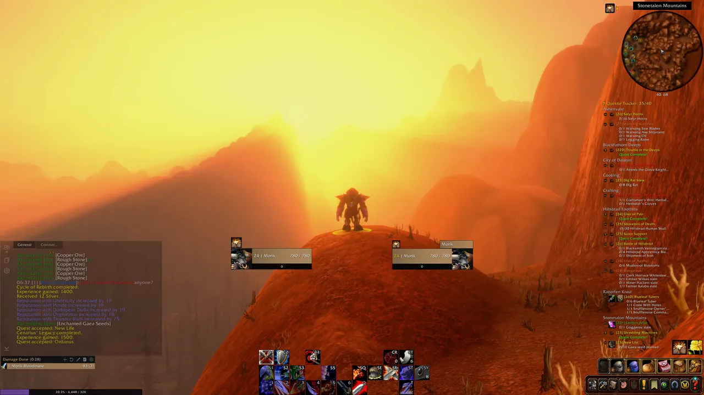
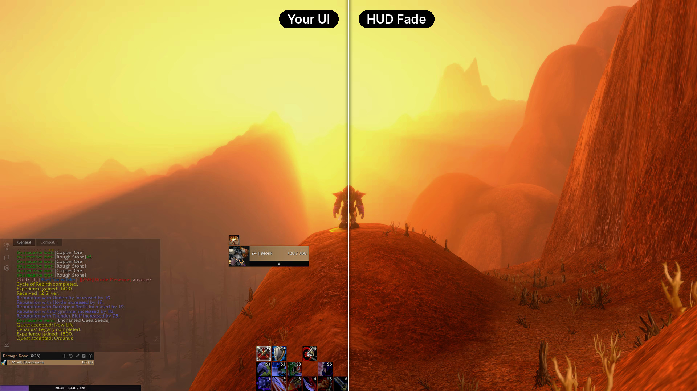

<picture>
  <source media="(prefers-color-scheme: dark)" srcset="https://raw.githubusercontent.com/AdrianMontanes/HUDFade/main/.github/icon-dark.png">
  
</picture>

# HUD Fade

Fade your entire World of Warcraft UI, including addon UIs, all at once. 
Made for immersion, OLED burn-in care and HUD-free screenshots and recordings.

## Why HUD Fade

Most fade addons set each frame's opacity one by one, and UI addons like EllesmereUI do the same for their own mouseover rules, so the two fight: flicker, bars popping back, art showing through. HUD Fade fades the one layer every frame sits on instead, so your UI addons keep working underneath. It also handles what lives outside that layer: 3D portraits, names, chat bubbles, nameplates, damage numbers and the target circle.

## Features

- **One key hides everything.** Your Hide UI key (Alt+Z) now fades smoothly and is safe in combat.
- **Comes back when it matters:** combat, a target, a window, typing in chat, dying. Each can be switched off.
- **Hides when idle** after 30 seconds (adjustable). Turning the camera doesn't wake it, so you can take in the view.
- **Clean screenshots:** a key that takes one with no HUD, names or chat bubbles, then puts everything back.
- **Hold to peek** at the HUD while it's hidden.
- **Minimap button:** left-click for settings, right-click to turn HUD Fade on or off, shift-click for a clean screenshot.
- **Pixel shift:** moves the whole UI a pixel or two every few minutes to spread OLED wear. Optional, never in combat.
- **Dim instead of hide:** hidden opacity from 0% (true black) up to 50%.
- **Your call on the world:** hide names, nameplates and damage numbers too, or leave them like the game's own Hide UI does.

No setup per addon and no reload. Keys for hide/show, peek, screenshot and on/off are in the game's Key Bindings, under AddOns.

## Commands

| Command | What it does |
| :--- | :--- |
| `/hudfade` | Open the settings |
| `/hudfade toggle` | Hide or show the HUD (also `show` and `hide`) |
| `/hudfade on` / `off` | Turn HUD Fade on or off |
| `/hudfade shot` | Take a screenshot without the HUD |
| `/hudfade minimap` | Show or hide the minimap button |
| `/hudfade shift` | Pixel shift status (also `on`, `off`, and `now` to see a move) |
| `/hudfade why` | Say what is keeping the HUD visible |
| `/hudfade what` | Name the UI element under the mouse |
| `/hudfade reset` | Go back to the default settings |

`/hfade` works too, as a shorter `/hudfade`.

## Install

- **CurseForge:** install it from the [HUD Fade page](https://www.curseforge.com/wow/addons/hud-fade), or search for HUD Fade in the CurseForge app.
- **Wago or WowUp:** install it from the [Wago page](https://addons.wago.io/addons/QNl4ZaNe), or search for HUD Fade in the Wago app or WowUp.
- **By hand:** download the zip from [Releases](https://github.com/AdrianMontanes/HUDFade/releases/latest) and unzip it into `World of Warcraft\_forever_\Interface\AddOns` (or `_retail_` for Retail), so you end up with an `AddOns\HUDFade` folder.

Made and tested on WoW Forever. Retail (12.x) runs on the same engine, so it should work there too. If something doesn't, please [open an issue](https://github.com/AdrianMontanes/HUDFade/issues/new/choose).

## Alt+Z opens the NVIDIA overlay?

The NVIDIA app uses Alt+Z for its overlay too. Change the overlay's shortcut in the NVIDIA app, or bind the game's Hide UI to another key. NVIDIA's own screenshots (Alt+F1) can't hide the HUD, so hide it first.

## Something stays visible?

Hover it, type `/hudfade what`, and [open an issue](https://github.com/AdrianMontanes/HUDFade/issues/new/choose) with what it printed and which UI addons you use.

## Recording in HDR?

Try [REPLAYD](https://replayd.download/with/hudfade), my native game recorder for Windows, built from scratch with HDR and OLED monitors in mind.

## Like HUD Fade?

It's free and always will be. If you'd like to say thanks, you can buy me a coffee:

